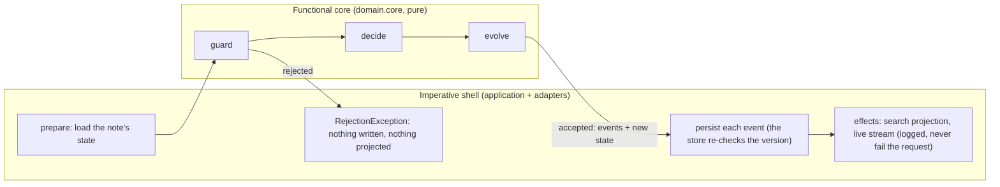

# team-notes-service

A REST back end for notes that small teams capture, share and work on together. Java 25, Spring Boot 4.1, Spring Web MVC, Spring Security. Runs with no external dependencies; Cassandra is the target production store and its data model is designed in (see below).

## Quick start

```bash
./mvnw -q -pl service -DskipTests package
java -jar service/target/team-notes-service.jar
```

The service listens on `http://localhost:8080` and seeds three users and two teams on first start: `alice` (`alice-pw`, admin of team `platform`, also the service admin), `bob` (`bob-pw`, member of `platform`, admin of `data`) and `carol` (`carol-pw`, member of `data`), plus three sample notes. Swagger UI is at `http://localhost:8080/swagger-ui.html`, the OpenAPI document at `/v3/api-docs`, health at `/actuator/health`.

A first walk (every call uses HTTP Basic):

```bash
curl -u alice:alice-pw localhost:8080/api/me
TEAM=$(curl -s -u alice:alice-pw localhost:8080/api/me | python3 -c 'import sys,json;print(json.load(sys.stdin)["teams"][0]["id"])')
curl -u alice:alice-pw -H 'Content-Type: application/json' -d "{\"title\":\"Heron sightings\",\"body\":\"# Log\\n\\nTwo herons at the *pond*.\",\"bodyFormat\":\"MARKDOWN\",\"tags\":[\"birds\"],\"visibility\":\"TEAM\",\"teamId\":\"$TEAM\"}" localhost:8080/api/notes
# bob (a platform member) appends an entry to the whiteboard; carol (not a member) gets 404; alice makes it ORGANIZATION-wide; carol finds it
curl -u bob:bob-pw -H 'Content-Type: application/json' -d '{"body":"saw a **third** one","bodyFormat":"MARKDOWN"}' localhost:8080/api/notes/<id>/entries
curl -u alice:alice-pw -X PUT -H 'Content-Type: application/json' -d '{"title":"Heron sightings","body":"now org wide","visibility":"ORGANIZATION","tags":["birds"],"version":1}' localhost:8080/api/notes/<id>
curl -u carol:carol-pw 'localhost:8080/api/search?q=heron'
curl -u bob:bob-pw -F 'file=@memo.pdf;type=application/pdf' localhost:8080/api/notes/<id>/attachments   # its text becomes searchable
curl -N -u bob:bob-pw localhost:8080/api/notes/<id>/events                                              # live stream of changes
```

Every error is an RFC 9457 `application/problem+json` document with a stable `type` such as `urn:notes:problem:version-conflict`.

**Guided demo.** `bin/demo.sh` walks the whole API in thirteen narrated steps (visibility, the whiteboard and its per-entry versions, 403 vs 409, attachments and search inside a PDF, the live event stream, rendered HTML, archive, team roles, validation, paging, reindex, delete), printing each request, status and response. It starts the built jar if nothing answers on `NOTES_URL` (default `http://localhost:8080`) and stops it afterwards; `bin/demo.sh --quiet` prints statuses only. It needs `curl` and `python3`.

## What it does

- **Notes** have a title, a body in plain text or Markdown, tags, and a visibility: `PRIVATE` (owner only), `TEAM` (members of one team) or `ORGANIZATION` (every signed-in user). Owners edit, archive and delete; `GET /api/notes/{id}/html` renders the note and its entries to HTML with raw HTML escaped.
- **Shared whiteboard.** Anyone who can see a note appends **entries** to it. Each entry has its own author and version, so people editing different entries never conflict, and two edits of the same entry resolve with a 409 that carries the current version. `GET /api/notes/{id}/events` is a Server-Sent Events stream of every change to the note.
- **Attachments** (PDF, text, Markdown, PNG, JPEG by default, 10 MB max) are stored by content and metadata separately; the text of PDFs, text and Markdown files is extracted and indexed, so a search can hit what a PDF says.
- **Search across teams**, Stack Overflow style: `GET /api/search?q=&tag=&teamId=&visibility=&sort=RELEVANCE|NEWEST` over every note the caller may see, and `GET /api/notes/{id}/related` for similar notes (more-like-this over title, body, entries, attachments and tags), also visibility-filtered. Full-text relevance comes from Lucene in development and is designed to move to Elasticsearch unchanged.
- **Teams**: create a team (the creator is its first admin), add and remove members, change roles; the last admin can be neither demoted nor removed.
- **Optimistic concurrency**: `PUT` carries the `version` it read; a stale version answers 409 with `currentVersion`.
- **Keyset pagination** on note lists (`cursor`), offset pagination on search (relevance order has no natural keyset).

## API

| Method and path | Who | Codes |
|---|---|---|
| `GET /api/me` | anyone signed in | 200 |
| `POST /api/teams` `{name}` | anyone (becomes admin) | 201 |
| `GET /api/teams/{teamId}`, `/members`, `/notes?tag=&includeArchived=&limit=&cursor=` | member | 200 404 |
| `PUT /api/teams/{teamId}/members/{username}` `{role}` / `DELETE …` | admin (a member may remove themselves) | 200/204 403 404 409 |
| `POST /api/notes` `{title, body, bodyFormat?, tags, visibility, teamId?}` | anyone; TEAM needs membership | 201 400 403 |
| `GET /api/notes?tag=&includeArchived=&limit=&cursor=` | own notes | 200 400 |
| `GET /api/notes/{id}`, `GET …/html` | owner, team member, or anyone for ORGANIZATION | 200 404 |
| `PUT /api/notes/{id}` `{…, version}` | owner | 200 400 403 404 409 |
| `POST /api/notes/{id}/archive`, `/unarchive`, `DELETE /api/notes/{id}` | owner | 200/204 403 404 |
| `GET/POST /api/notes/{id}/entries`, `PUT/DELETE …/{entryId}` `{body, bodyFormat?, version}` | anyone who can see the note; edit by author; delete by author or owner | 200/201/204 400 403 404 409 |
| `GET/POST /api/notes/{id}/attachments` (multipart `file`), `GET/DELETE …/{attachmentId}` | as entries | 200/201/204 403 404 413 415 |
| `GET /api/notes/{id}/events` (`text/event-stream`) | anyone who can see the note | 200 404 |
| `GET /api/search?q=&tag=&teamId=&visibility=&includeArchived=&sort=&limit=&offset=` | anyone, filtered to what they may see | 200 400 |
| `GET /api/notes/{id}/related?limit=` | anyone who can see the note | 200 404 |
| `POST /api/admin/reindex` | `notes.admin-users` | 200 403 |

Not-visible and nonexistent notes both answer 404, so the API never reveals that a note exists to someone who may not see it; 403 is reserved for things the caller can see but may not do. Archived notes are read-only (no edits, entries or attachments) until unarchived.

## Architecture: functional core, imperative shell



The pattern follows the deciders in my Temporal commerce platform (nightheron-mono) without their state machines: notes have no lifecycle beyond archived, so a decider per aggregate is enough.

- `domain/core` is pure. Every command arrives already enriched by the shell with the request time and any new ids; configuration limits arrive as a value. The core never reads a clock, never generates an id, never does I/O and never throws for control flow. `ArchitectureTest` (ArchUnit) enforces this the way the mono's lint rules do.
- Per command, a **guard** returns the typed `Rejection` (`NotFound`, `Forbidden`, `VersionConflict`, `Invalid`, `LastAdmin`, `Unsupported`, `TooLarge`) or nothing; **decide** is then total and returns past-tense events (an empty list means "nothing to do", as when archiving an archived note); **evolve** is the single writer of state. `NoteDecider.apply` assembles guard, decide and fold into a `Decision`. One block per command, helpers used by one block directly after it, dispatchers last.
- The shell (`application`) runs prepare, apply, persist, effects. A rejection throws before any write. Version-conditional writes are re-checked by the store (`updateIfVersion`), so a race lost between prepare and persist surfaces as the same 409 the decider would have produced. Effects run after the writes and cannot fail the request; `POST /api/admin/reindex` is the repair path if a projection effect ever fails.
- Decider tests are plain JUnit over pure functions: one test per guard refusal and decision branch, a parameterised fold over every event type proving `evolve` returns new values and leaves its inputs untouched (the count is asserted against the sealed permits so a new event cannot be forgotten), and replay as a fold.

Packages: `domain/model` (records with structural invariants), `domain/core` (deciders, policy, text transforms), `application` (shell, queries) and `application/port` (the interfaces the adapters implement), `adapter/persistence/memory`, `adapter/blob`, `adapter/extract`, `adapter/search/lucene`, `adapter/events`, `adapter/web`, `config`.

## Storage: Cassandra as the target, zero dependencies in development

The storage port is **designed around Cassandra's query patterns** so that the in-memory adapter and a Cassandra adapter behave the same: lists are per partition (an owner's notes, a team's notes), newest first, filtered inside the partition, paged by a keyset cursor `(createdAt, noteId)` with UUIDs compared unsigned the way Cassandra compares them; timestamps are truncated to milliseconds, Cassandra's precision; updates are conditional on the stored version (`UPDATE … IF version = ?` in CQL, compare-and-set in memory); entries are a clustering row per note so appends never contend. The full table design is in [docs/cassandra-schema.cql](docs/cassandra-schema.cql): seven tables for the access patterns, full copies in the lookup tables (a note write touches at most three tables), the lightweight transaction on `notes_by_id`, attachment bytes as 256 KB chunk rows, and the stated tradeoff that the lookup batch is not atomic with the transaction.

The default profile uses an **in-memory store with an optional JSON snapshot**: plain maps behind one read/write lock, and, when `NOTES_STORE_SNAPSHOT_PATH` is set, the whole state written to that file after every mutation (temp file, fsync, atomic rename, so a crash never corrupts the previous snapshot). A missing file is an empty store; an unreadable one fails startup rather than silently starting empty and overwriting it. Attachment bytes go to a directory (`NOTES_ATTACHMENTS_DIR`). Limits stated plainly: whole-state writes, one process, no migrations beyond a schema version.

Alternatives I weighed for the development store:

| Option | Why not (or why) |
|---|---|
| In-memory maps + JSON snapshot (chosen) | One data model shared with the Cassandra design, nothing to install, every rule testable without a container. |
| H2 or SQLite via Spring Data JDBC/JPA | Familiar, but a second, relational data model for the same domain, and it invites joins the Cassandra model cannot do. |
| MapDB or RocksDB | Embedded key-value is closer to Cassandra's shape, but another library for what a map and a file already give. |
| ScyllaDB or Cassandra in Docker (`cassandra:5.0`) | The right thing for the real adapter and its contract tests (Testcontainers); not a zero-dependency development default. |
| nosan `embedded-cassandra` | Spawns a real Cassandra; Cassandra 5 needs JDK 11 or 17, impractical beside Java 25. |

For search the same logic applies: **Lucene in memory** in development (Elasticsearch is Lucene underneath, so ranking behaves the same) behind a `SearchIndex` port, Elasticsearch as the production adapter. Naive token matching was rejected because its ranking would differ from production and it cannot do more-like-this.

## Configuration

Every `notes.*` key in `service/src/main/resources/application.yml` can be set as an environment variable with Spring's relaxed binding.

| Setting | Env var | Default |
|---|---|---|
| HTTP port / bind address | `NOTES_PORT` / `NOTES_ADDRESS` | 8080 / 0.0.0.0 |
| JSON snapshot path (unset = memory only) | `NOTES_STORE_SNAPSHOT_PATH` | unset |
| Attachment directory | `NOTES_ATTACHMENTS_DIR` | `./data/attachments` |
| Attachment max size / allowed types | `NOTES_ATTACHMENTS_MAX_SIZE` / `NOTES_ATTACHMENTS_ALLOWED_TYPES` | 10MB / pdf, text, markdown, png, jpeg |
| Service admins (reindex) | `NOTES_ADMIN_USERS` | alice |
| Seed users and teams | `notes.seed.*` | three users, two teams |
| bcrypt strength | `NOTES_SECURITY_BCRYPT_STRENGTH` | 10 |
| SSE heartbeat / timeout | `NOTES_SSE_HEARTBEAT` / `NOTES_SSE_TIMEOUT` | 15s / 30m |
| Content limits | `notes.limits.*` | title 200, body 20000, 20 tags, 500 entries, 20 attachments |
| CORS origins for a browser UI | `NOTES_CORS_ALLOWED_ORIGINS` | `http://localhost:3000` |

## Tradeoffs, stated

- **HTTP Basic with bcrypt users in the store.** Real authentication with one configuration class; the production path is OAuth2 or JWT behind a gateway, which replaces one filter chain and nothing in the domain.
- **`version` in the request body** rather than `ETag`/`If-Match`: one concurrency mechanism and simple `curl` examples. Deletes and archive are unconditional because they are idempotent.
- **Dual write to the search index without an outbox.** The projection runs after the store write in the same request; a crash between the two leaves the index stale until the next write or a reindex. An outbox or change feed is the fix when it matters.
- **Live stream fan-out is in-process.** Subscribers live in the instance that accepted them; a multi-instance deployment needs a shared bus.
- **Text extraction is synchronous** in the upload request, capped at 100 000 characters; an asynchronous job is the upgrade.
- **Filtering inside a partition** (`ALLOW FILTERING` restricted to one owner or team) is the Cassandra choice for tags and archived flags at "several small teams" scale; per-tag tables are the next step.
- **No signup endpoint**: users are seeded or added by configuration. A `POST /api/users` is a one-block addition to the shell.

## Testing

```bash
./mvnw verify
```

Architecture rules (ArchUnit), decider tests over the pure core, shell tests over the in-memory adapters with a fixed clock, contract tests for the store, blob store and search index (shared abstract classes so a Cassandra or Elasticsearch adapter runs the same suite), Markdown, extraction and cursor tests. CI builds on Java 25, runs the suite, boots the jar and exercises the API.

## Roadmap (designed, not yet built)

Time-boxed cut: the following were designed for this service and are the next units of work, in order.

1. **Cassandra adapter** behind the `cassandra` profile over the schema in `docs/cassandra-schema.cql`: hand-written CQL through `CassandraTemplate` (lightweight transactions, logged batches, tuple cursors), docker-compose for development, Testcontainers against `cassandra:5.0` running the existing store and blob contract tests.
2. **Elasticsearch adapter** behind the `elasticsearch` profile over `ElasticsearchClient` (`multi_match`, `more_like_this`, `refresh=wait_for`), running the existing search contract tests under Testcontainers.
3. **CLI for people and agents** (`notes`, picocli, no Spring): subcommands mirroring the API, `--json` output, stable exit codes, `notes watch` over the event stream, and a `notes demo` that plays the whole scenario so an agent can learn the API from one run.
4. **Browser UI** as a separate Next.js project talking directly to this API (the CORS allowlist is already here).

## Layout

```
pom.xml                 root; module: service (the REST service)
service/                Spring Boot application, tests, application.yml
docs/cassandra-schema.cql
.github/workflows/ci.yml
```
