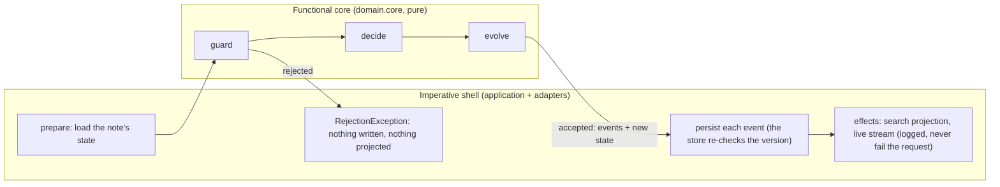

# team-notes-service

A REST back end for notes that small teams capture, share and work on together. Java 25, Spring Boot 4.1, Spring Web MVC, Spring Security. Runs with no external dependencies; Cassandra is the target production store and its data model is designed in (see below).

## Quick start

Needs a JDK 25 on `PATH` or in `JAVA_HOME` (`sdk use java 25.0.4-tem` with sdkman). The Maven wrapper fetches Maven itself.

```bash
./mvnw -q -pl service -DskipTests package
java -jar service/target/team-notes-service.jar
```

The service listens on `http://localhost:8080` and seeds three users and two teams on first start: `alice` (`alice-pw`, admin of team `platform`, also the service admin), `bob` (`bob-pw`, member of `platform`, admin of `data`) and `carol` (`carol-pw`, member of `data`), plus three sample notes. Swagger UI is at `http://localhost:8080/swagger-ui.html`, the OpenAPI document at `/v3/api-docs`, health at `/actuator/health`.

A first walk (every call uses HTTP Basic; paste the block into a bash or zsh shell while the service is running):

```bash
curl -u alice:alice-pw localhost:8080/api/me
TEAM=$(curl -s -u alice:alice-pw localhost:8080/api/me | python3 -c 'import sys,json; print(json.load(sys.stdin)["teams"][0]["id"])')
printf '{"title":"Heron sightings","body":"# Log\\n\\nTwo herons at the *pond*.","bodyFormat":"MARKDOWN","tags":["birds"],"visibility":"TEAM","teamId":"%s"}' "$TEAM" > /tmp/note.json
NOTE=$(curl -s -u alice:alice-pw -H 'Content-Type: application/json' -d @/tmp/note.json localhost:8080/api/notes | python3 -c 'import sys,json; print(json.load(sys.stdin)["id"])')
echo "note $NOTE"
# bob (a platform member) appends an entry to the whiteboard; carol (not a member) gets 404
curl -u bob:bob-pw -H 'Content-Type: application/json' -d '{"body":"saw a **third** one","bodyFormat":"MARKDOWN"}' localhost:8080/api/notes/$NOTE/entries
curl -s -o /dev/null -w 'carol -> HTTP %{http_code}\n' -u carol:carol-pw localhost:8080/api/notes/$NOTE
# alice makes it ORGANIZATION-wide (version 1 is the version she read); now carol finds it
curl -u alice:alice-pw -X PUT -H 'Content-Type: application/json' -d '{"title":"Heron sightings","body":"now org wide","visibility":"ORGANIZATION","tags":["birds"],"version":1}' localhost:8080/api/notes/$NOTE
curl -u carol:carol-pw 'localhost:8080/api/search?q=heron'
# an attachment's text becomes searchable (PDF, text and Markdown are extracted)
printf 'kestrel budget memo' > /tmp/memo.txt
curl -u bob:bob-pw -F 'file=@/tmp/memo.txt;type=text/plain' localhost:8080/api/notes/$NOTE/attachments
curl -u carol:carol-pw 'localhost:8080/api/search?q=kestrel'
# the live stream of the note's changes (Ctrl-C to stop)
curl -N -u bob:bob-pw localhost:8080/api/notes/$NOTE/events
```

Every error is an RFC 9457 `application/problem+json` document with a stable `type` such as `urn:notes:problem:version-conflict`.

**Guided demo.** `bin/demo.sh` walks the whole API in thirteen narrated steps (visibility, the whiteboard and its per-entry versions, 403 vs 409, attachments and search inside a PDF, the live event stream, rendered HTML, archive, team roles, validation, paging, reindex, delete), printing each request, status and response. It starts the built jar if nothing answers on `NOTES_URL` (default `http://localhost:8080`) and stops it afterwards; `bin/demo.sh --quiet` prints statuses only. It needs `curl` and `python3`.

## What it does

- **Notes** have a title, a body in plain text or Markdown, tags, and a visibility: `PRIVATE` (owner only), `TEAM` (members of one team) or `ORGANIZATION` (every signed-in user). Owners edit, archive and delete; `GET /api/notes/{id}/html` renders the note and its entries to HTML with raw HTML escaped.
- **Shared whiteboard.** Anyone who can see a note appends **entries** to it. Each entry has its own author and version, so people editing different entries never conflict, and two edits of the same entry resolve with a 409 that carries the current version. `GET /api/notes/{id}/events` is a Server-Sent Events stream of every change to the note.
- **Attachments** (PDF, text, Markdown, PNG, JPEG by default, 10 MB max) are stored by content and metadata separately; the text of PDFs, text and Markdown files is extracted and indexed, so a search can hit what a PDF says.
- **Search across teams**, Stack Overflow style: `GET /api/search?q=&tag=&teamId=&visibility=&sort=RELEVANCE|NEWEST` over every note the caller may see, and `GET /api/notes/{id}/related` for similar notes (more-like-this over title, body, entries, attachments and tags), also visibility-filtered. Full-text relevance comes from Lucene in development and is designed to move to Elasticsearch unchanged.
- **Teams**: create a team (the creator is its first admin), add and remove members, change roles; the last admin can be neither demoted nor removed.
- **Optimistic concurrency**: `PUT` carries the `version` it read; a stale version answers 409 with `currentVersion`.
- **Keyset pagination** on note lists (`cursor`), offset pagination on search (relevance order has no natural keyset).

## Design choices

Two decisions shaped everything else. The sections further down give the detail; this is the reasoning.

### 1. Cassandra as the target store, reached through a port shaped like Cassandra

**What I chose.** The storage interfaces (`application/port`) are designed around Cassandra's query patterns rather than around a generic repository: lists are per partition (one owner's notes, one team's notes), newest first, filtered inside the partition, paged by a keyset cursor of `(createdAt, noteId)`; updates are conditional on the stored version, which is a lightweight transaction in CQL; whiteboard entries are a row per note so concurrent appends never contend; attachment bytes are chunk rows. The default adapter is an in-memory implementation of exactly those semantics, with an optional JSON snapshot, and the Cassandra table design is written down in [docs/cassandra-schema.cql](docs/cassandra-schema.cql).

**Why.** Notes shared among teams are a write-heavy, partition-friendly workload: almost every read is "this owner's notes" or "this team's notes", newest first, which is one Cassandra partition read. Designing the port that way first means the in-memory adapter and a Cassandra adapter behave the same, so the contract tests written now (`AbstractStoreContractTest`) are the acceptance tests for the Cassandra adapter later, and nothing in the domain or the API changes when it lands. It also keeps development honest: there is no second, relational data model that would tempt joins Cassandra cannot do. The detailed alternatives I weighed for the development store (H2, SQLite, MapDB, ScyllaDB in Docker, embedded Cassandra) are in the storage section.

**What it cost.** Some things are harder than in a relational store and the design says so: tag and archived filters scan inside a partition (`ALLOW FILTERING` restricted to one owner or team) rather than using an index; search is a separate projection (Lucene now, Elasticsearch later) because Cassandra does not do relevance; the lookup-table batch is not atomic with the version check, so a crash between them leaves a stale list copy until the next write; the Cassandra adapter itself is not in this cut, so today the service runs on the in-memory adapter only. Even the UUID ordering in the in-memory adapter is Cassandra's unsigned comparison, so that cursors agree byte for byte.

### 2. Functional core, imperative shell, without a state machine

**What I chose.** All business rules live in a pure core (`domain/core`): per command, a `guard` that returns a typed `Rejection` or nothing, a `decide` that is total once guarded and returns past-tense events, and an `evolve` that folds events into state. The shell (`application`) does everything impure in a fixed order: load state, apply the pure decision, persist the events, run the post-commit effects (search projection, live stream). Time and new ids are generated in the shell and placed on the command before it reaches the core; configuration limits enter as a value. An ArchUnit test fails the build if the core reads a clock, generates an id, or depends on Spring or an adapter. I use similar patterns in my personal work, where they are aimed at systems that are clear and understandable to both developers and AI, and focused on scalability, durable execution, reliability and observability; here I left out the explicit state machines those systems use, because a note has no lifecycle beyond archived or not.

**Why.** Correctness is judged on rules like "an outsider gets 404, a member who is not the owner gets 403, a stale version gets 409 with the current version, the last admin cannot be demoted". With a pure core each rule is one small test over values, with no Spring context, no mocks and no database; the whole suite of a hundred tests runs in a few seconds. The same split makes the concurrency story explicit: the core compares versions logically, the store re-checks them atomically, and a race lost in between surfaces as the same 409. It also makes the effects honest: a failing search projection is logged and never turns a committed write into an error response, and the one place that swallows a failure is named as such.

**What it cost.** More types than a service-and-repository layout: sealed commands, events and rejections, a state record per aggregate, and a shell that maps events to repository calls. Some validation is duplicated at the edges (Bean Validation checks presence, the core checks content) so that the core can refuse with a typed rejection instead of an exception. And without a state machine there is no declarative transition table to read; the decider file's one-block-per-command layout is what stands in for it.

## API

| Method and path | Who | Codes |
|---|---|---|
| `GET /api/me` | anyone signed in | 200 |
| `POST /api/teams` `{name}` | anyone (becomes admin) | 201 |
| `GET /api/teams/{teamId}`, `/members`, `/notes?tag=&includeArchived=&limit=&cursor=` | member | 200 404 |
| `PUT /api/teams/{teamId}/members/{username}` `{role}` / `DELETE …` | admin (a member may remove themselves) | 200/204 403 404 409 |
| `POST /api/notes` `{title, body, bodyFormat?, tags, visibility, teamId?}` | anyone; TEAM needs membership | 201 400 403 |
| `GET /api/notes?tag=&includeArchived=&limit=&cursor=` | own notes | 200 400 |
| `GET /api/notes/{id}`, `GET …/html` | owner, team member, or anyone for ORGANIZATION | 200 404 |
| `PUT /api/notes/{id}` `{…, version}` | owner | 200 400 403 404 409 |
| `POST /api/notes/{id}/archive`, `/unarchive`, `DELETE /api/notes/{id}` | owner | 200/204 403 404 |
| `GET/POST /api/notes/{id}/entries`, `PUT/DELETE …/{entryId}` `{body, bodyFormat?, version}` | anyone who can see the note; edit by author; delete by author or owner | 200/201/204 400 403 404 409 |
| `GET/POST /api/notes/{id}/attachments` (multipart `file`), `GET/DELETE …/{attachmentId}` | as entries | 200/201/204 403 404 413 415 |
| `GET /api/notes/{id}/events` (`text/event-stream`) | anyone who can see the note | 200 404 |
| `GET /api/search?q=&tag=&teamId=&visibility=&includeArchived=&sort=&limit=&offset=` | anyone, filtered to what they may see | 200 400 |
| `GET /api/notes/{id}/related?limit=` | anyone who can see the note | 200 404 |
| `POST /api/admin/reindex` | `notes.admin-users` | 200 403 |

Not-visible and nonexistent notes both answer 404, so the API never reveals that a note exists to someone who may not see it; 403 is reserved for things the caller can see but may not do. Archived notes are read-only (no edits, entries or attachments) until unarchived.

## Architecture: functional core, imperative shell



I use similar patterns in my personal work, aimed at systems that are clear and understandable to both developers and AI and focused on scalability, durable execution, reliability and observability. This service uses them without state machines: notes have no lifecycle beyond archived, so a decider per aggregate is enough.

- `domain/core` is pure. Every command arrives already enriched by the shell with the request time and any new ids; configuration limits arrive as a value. The core never reads a clock, never generates an id, never does I/O and never throws for control flow. `ArchitectureTest` (ArchUnit) enforces this at build time.
- Per command, a **guard** returns the typed `Rejection` (`NotFound`, `Forbidden`, `VersionConflict`, `Invalid`, `LastAdmin`, `Unsupported`, `TooLarge`) or nothing; **decide** is then total and returns past-tense events (an empty list means "nothing to do", as when archiving an archived note); **evolve** is the single writer of state. `NoteDecider.apply` assembles guard, decide and fold into a `Decision`. One block per command, helpers used by one block directly after it, dispatchers last.
- The shell (`application`) runs prepare, apply, persist, effects. A rejection throws before any write. Version-conditional writes are re-checked by the store (`updateIfVersion`), so a race lost between prepare and persist surfaces as the same 409 the decider would have produced. Effects run after the writes and cannot fail the request; `POST /api/admin/reindex` is the repair path if a projection effect ever fails.
- Decider tests are plain JUnit over pure functions: one test per guard refusal and decision branch, a parameterised fold over every event type proving `evolve` returns new values and leaves its inputs untouched (the count is asserted against the sealed permits so a new event cannot be forgotten), and replay as a fold.

Packages: `domain/model` (records with structural invariants), `domain/core` (deciders, policy, text transforms), `application` (shell, queries) and `application/port` (the interfaces the adapters implement), `adapter/persistence/memory`, `adapter/blob`, `adapter/extract`, `adapter/search/lucene`, `adapter/events`, `adapter/web`, `config`.

## Storage: Cassandra as the target, zero dependencies in development

The storage port is **designed around Cassandra's query patterns** so that the in-memory adapter and a Cassandra adapter behave the same: lists are per partition (an owner's notes, a team's notes), newest first, filtered inside the partition, paged by a keyset cursor `(createdAt, noteId)` with UUIDs compared unsigned the way Cassandra compares them; timestamps are truncated to milliseconds, Cassandra's precision; updates are conditional on the stored version (`UPDATE … IF version = ?` in CQL, compare-and-set in memory); entries are a clustering row per note so appends never contend. The full table design is in [docs/cassandra-schema.cql](docs/cassandra-schema.cql): seven tables for the access patterns, full copies in the lookup tables (a note write touches at most three tables), the lightweight transaction on `notes_by_id`, attachment bytes as 256 KB chunk rows, and the stated tradeoff that the lookup batch is not atomic with the transaction.

The default profile uses an **in-memory store with an optional JSON snapshot**: plain maps behind one read/write lock, and, when `NOTES_STORE_SNAPSHOT_PATH` is set, the whole state written to that file after every mutation (temp file, fsync, atomic rename, so a crash never corrupts the previous snapshot). A missing file is an empty store; an unreadable one fails startup rather than silently starting empty and overwriting it. Attachment bytes go to a directory (`NOTES_ATTACHMENTS_DIR`). Limits stated plainly: whole-state writes, one process, no migrations beyond a schema version.

Alternatives I weighed for the development store:

| Option | Why not (or why) |
|---|---|
| In-memory maps + JSON snapshot (chosen) | One data model shared with the Cassandra design, nothing to install, every rule testable without a container. |
| H2 or SQLite via Spring Data JDBC/JPA | Familiar, but a second, relational data model for the same domain, and it invites joins the Cassandra model cannot do. |
| MapDB or RocksDB | Embedded key-value is closer to Cassandra's shape, but another library for what a map and a file already give. |
| ScyllaDB or Cassandra in Docker (`cassandra:5.0`) | The right thing for the real adapter and its contract tests (Testcontainers); not a zero-dependency development default. |
| nosan `embedded-cassandra` | Spawns a real Cassandra; Cassandra 5 needs JDK 11 or 17, impractical beside Java 25. |

For search the same logic applies: **Lucene in memory** in development (Elasticsearch is Lucene underneath, so ranking behaves the same) behind a `SearchIndex` port, Elasticsearch as the production adapter. Naive token matching was rejected because its ranking would differ from production and it cannot do more-like-this.

## Configuration

Every `notes.*` key in `service/src/main/resources/application.yml` can be set as an environment variable with Spring's relaxed binding.

| Setting | Env var | Default |
|---|---|---|
| HTTP port / bind address | `NOTES_PORT` / `NOTES_ADDRESS` | 8080 / 0.0.0.0 |
| JSON snapshot path (unset = memory only) | `NOTES_STORE_SNAPSHOT_PATH` | unset |
| Attachment directory | `NOTES_ATTACHMENTS_DIR` | `./data/attachments` |
| Attachment max size / allowed types | `NOTES_ATTACHMENTS_MAX_SIZE` / `NOTES_ATTACHMENTS_ALLOWED_TYPES` | 10MB / pdf, text, markdown, png, jpeg |
| Service admins (reindex) | `NOTES_ADMIN_USERS` | alice |
| Seed users and teams | `notes.seed.*` | three users, two teams |
| bcrypt strength | `NOTES_SECURITY_BCRYPT_STRENGTH` | 10 |
| SSE heartbeat / timeout | `NOTES_SSE_HEARTBEAT` / `NOTES_SSE_TIMEOUT` | 15s / 30m |
| Content limits | `notes.limits.*` | title 200, body 20000, 20 tags, 500 entries, 20 attachments |
| CORS origins for a browser UI | `NOTES_CORS_ALLOWED_ORIGINS` | `http://localhost:3000` |

## Tradeoffs, stated

- **HTTP Basic with bcrypt users in the store.** Real authentication with one configuration class; the production path is OAuth2 or JWT behind a gateway, which replaces one filter chain and nothing in the domain.
- **`version` in the request body** rather than `ETag`/`If-Match`: one concurrency mechanism and simple `curl` examples. Deletes and archive are unconditional because they are idempotent.
- **Dual write to the search index without an outbox.** The projection runs after the store write in the same request; a crash between the two leaves the index stale until the next write or a reindex. An outbox or change feed is the fix when it matters.
- **Live stream fan-out is in-process.** Subscribers live in the instance that accepted them; a multi-instance deployment needs a shared bus.
- **Text extraction is synchronous** in the upload request, capped at 100 000 characters; an asynchronous job is the upgrade.
- **Filtering inside a partition** (`ALLOW FILTERING` restricted to one owner or team) is the Cassandra choice for tags and archived flags at "several small teams" scale; per-tag tables are the next step.
- **No signup endpoint**: users are seeded or added by configuration. A `POST /api/users` is a one-block addition to the shell.

## Testing

```bash
./mvnw verify
```

Architecture rules (ArchUnit), decider tests over the pure core, shell tests over the in-memory adapters with a fixed clock, contract tests for the store, blob store and search index (shared abstract classes so a Cassandra or Elasticsearch adapter runs the same suite), Markdown, extraction and cursor tests. CI builds on Java 25, runs the suite, boots the jar and exercises the API.

## If I had more time

This was a time-boxed cut. What follows is what I would add, change and stop doing next, in that order of priority.

### Add

1. **The Cassandra adapter** behind a `cassandra` profile, over the schema in `docs/cassandra-schema.cql`: hand-written CQL through the DataStax driver (lightweight transactions for the version checks, logged batches for the lookup tables, tuple comparisons for the cursor), a `compose.yaml` for development, and Testcontainers against `cassandra:5.0` running the existing store and blob contract tests unchanged. The port was shaped for this, so the work is the adapter and its tests, not the domain or the API.
2. **The Elasticsearch adapter** behind an `elasticsearch` profile over the Elasticsearch Java client (`multi_match`, `more_like_this`, `refresh=wait_for`), running the existing search contract tests under Testcontainers. Lucene stays the development index.
3. **A CLI for people and agents** (`notes`, picocli, no Spring): subcommands mirroring the API, `--json` output, stable exit codes, `notes watch` over the event stream, and a `notes demo` that plays the scenario `bin/demo.sh` plays today, so an agent can learn the API from one run.
4. **A browser UI** as a separate Next.js project talking directly to this API; the CORS allowlist is already here.
5. **A signup endpoint** and a per-user sharing rule (share one note with named people outside its team), both one block each in the deciders.
6. **Votes and a score** on notes, so cross-team search can sort by what people found useful, completing the Stack Overflow shape.

### Change

- **Replace the synchronous dual write with an outbox or a change feed.** Today the search projection runs in the request after the store write; a crash between the two leaves the index stale until a reindex. With Cassandra in place the natural fix is an outbox table drained by a worker, which also removes the "effects are logged and swallowed" exception from the shell.
- **Move text extraction out of the upload request.** Extract asynchronously, index when done, and show `textExtracted: false` until then; large PDFs would stop holding a request thread.
- **Fan the live stream out through a shared bus** (Redis pub/sub or Kafka) so Server-Sent Events work across several instances.
- **Swap HTTP Basic for OAuth2 or JWT behind a gateway.** The domain never sees the mechanism, so this is one filter chain.
- **Give tags their own lookup tables** (`notes_by_owner_tag`, `notes_by_team_tag`) once tag filtering is hot enough that an in-partition scan shows up.

### Stop

- **Stop rebuilding the whole search index at startup.** It is right for an in-memory Lucene index and wrong for Elasticsearch over a large store; with the Elasticsearch adapter the startup reindex becomes an explicit admin action only.
- **Stop writing the whole in-memory state to the JSON snapshot on every mutation.** It is the simplest correct thing for development and it will not scale; once the Cassandra adapter exists the snapshot is a development convenience and should say so, or go.
- **Stop seeding sample notes and dev passwords by default.** Users and teams seeded from configuration are fine for a demo; a deployed instance should start empty, with `notes.seed.enabled=false` the default and credentials supplied, not shipped.
- **Stop letting one request do a write and a projection.** This is the same point as the outbox above, seen from the other side: the request should end when the store write is durable.

## Commit history

| Commit | When (MDT) | What |
|---|---|---|
| `9cb01d2` | 2026-10-12 13:14 | feat: team-notes-service, a shared note-taking REST back end (Java 25, Spring Boot 4.1) |
| `139fdd2` | 2026-10-12 13:29 | docs: narrated API demo script and a corrected core/shell diagram |
| `f6f6ad1` | 2026-10-12 13:31 | fix(demo): pick a JDK 25 to start the service and fail with a message instead of silently |
| (this commit) | 2026-10-12 | docs: design choices, what I would add/change/stop, a working first walk, commit history |

The first commit is the whole service built in one session under a deadline; the rest are the demo script and documentation. Branch `main` only; every push ran the CI workflow (build, tests, boot the jar and exercise the API) and each run concluded successfully.

## Layout

```
pom.xml                 root; module: service (the REST service)
service/                Spring Boot application, tests, application.yml
docs/cassandra-schema.cql
.github/workflows/ci.yml
```
